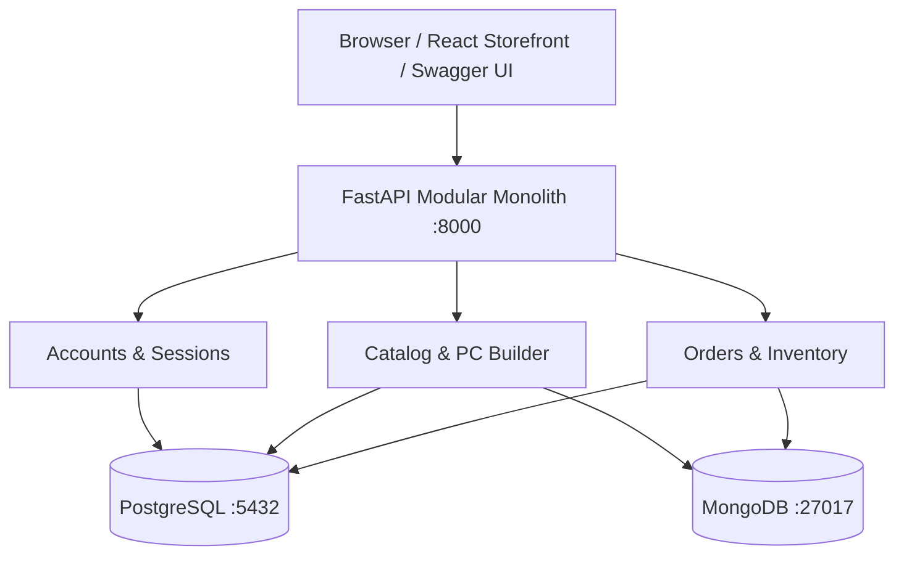
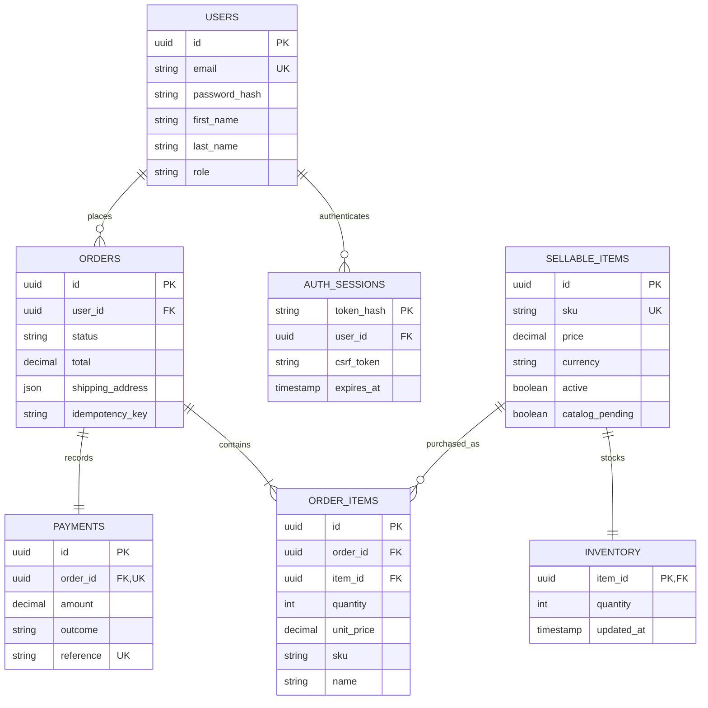

# PC Parts & Electronics Store (CP1 • CP2 • CP3)
**Course:** 269340 Data Centric Application Development (2026)  
**Department of Computer Engineering, Faculty of Engineering, Chiang Mai University**

---

## Quick Navigation

- [Team Roster](#team-roster)
- [Quick Start (Docker Setup)](#run-the-project)
- [Checkpoint 3: Concurrency Control & Performance Audit](#checkpoint-3-concurrency-control--performance-audit-week-16)
  - [CP3 Deliverables & Verification Checklist](#cp3-deliverables-checklist)
  - [PCC vs. OCC Implementation](#concurrency-control-implementation)
  - [Query Projection & N+1 Elimination](#query-projection--n1-query-elimination)
  - [Automated Load Benchmark & Verification Commands](#automated-load-benchmark--verification-commands)
- [Checkpoint 2: Zero-Downtime Schema Migration (Expand & Contract)](#checkpoint-2-zero-downtime-schema-migration-week-12)
- [Checkpoint 1: Core Dual-Database Architecture](#checkpoint-1-core-dual-database-architecture-week-11)

---

## Team Roster

| Responsibility | Team Member | Student ID |
|---|---|---|
| PostgreSQL, Checkout & Concurrency Locking | METHAS RUTTANABUREE | 670615033 |
| MongoDB, Catalog & Query Projection | KOMET SASISON | 670615019 |
| REST API, Authentication & Concurrency Tests | HARUTO ABURATANI | 670615518 |
| Docker Orchestration, Frontend & Audit Reports | WARINTHON TOSAK | 670615034 |

---

## Run the project

Requirements: Docker Desktop with Linux containers and Docker Compose.

```sh
docker compose up -d --build
docker compose exec -T api python -m app.seed
docker compose ps
```

- **Storefront & 3D PC Builder:** `http://localhost:3000`
- **FastAPI Documentation (Swagger UI):** `http://localhost:8000/docs`
- **Dual-Database Health Check:** `http://localhost:8000/api/v1/health`

Default local demonstration accounts:

| Role | Email | Password |
|---|---|---|
| Administrator | `admin@example.com` | `LocalAdmin123!` |
| Customer | `customer@example.com` | `LocalCustomer123!` |

---

## Checkpoint 3: Concurrency Control & Performance Audit (Week 16)

> **Official Deliverables Report:**
> - Markdown Report: [`PERFORMANCE_AUDIT_REPORT.md`](PERFORMANCE_AUDIT_REPORT.md)
> - PDF Report: [`Performance_Audit_Report.pdf`](Performance_Audit_Report.pdf)

### CP3 Deliverables Checklist

- [x] **Concurrency Control Implementation:**
  - **Pessimistic Concurrency Control (PCC):** PostgreSQL row-level locks (`SELECT FOR UPDATE`) on order creation with deterministic UUID sorting to eliminate transaction deadlocks (`backend/app/orders.py`).
  - **Optimistic Concurrency Control (OCC):** Timestamp version tokens (`version_timestamp`) rejecting stale mutations with HTTP 409 Conflict (`backend/app/catalog.py`).
- [x] **Concurrency Verification Script:** Automated barrier-synchronized race condition test (`test_concurrency.py`).
- [x] **Query Projection Optimization (Zero N+1):** Scalar SQL selection (`select(...)`) for catalog and order summaries, cutting query overhead to $O(1)$ and reducing memory footprint by ~95%.
- [x] **Automated Load Testing Benchmark:** 50 Concurrent Virtual Users (VUs) for 3 minutes (180s) maintaining stable throughput, p95 < 200ms, and error rate < 1% (`run_benchmark.py`, `k6_script.js`, `locustfile.py`).
- [x] **Performance Audit Report:** Documented results in [`PERFORMANCE_AUDIT_REPORT.md`](PERFORMANCE_AUDIT_REPORT.md) and [`Performance_Audit_Report.pdf`](Performance_Audit_Report.pdf).

---

### Concurrency Control Implementation

#### 1. Pessimistic Concurrency Control (PCC) & Deadlock Elimination
In `POST /api/v1/orders`, concurrent requests attempt to reserve shared inventory rows.
```python
# Acquire row locks in deterministic UUID sort order to mathematically eliminate deadlocks
stmt = (
    select(Inventory)
    .where(Inventory.item_id.in_(requested_item_ids))
    .order_by(Inventory.item_id)
    .with_for_update()
)
```
- **Deadlock Prevention:** When multiple items are purchased together, locks are always acquired in strictly ascending UUID order. Circular wait conditions cannot occur.
- **Lost Update Prevention:** The database serializes updates; if stock is depleted, subsequent waiting transactions immediately read stock as 0 and abort with HTTP 409 Conflict without modifying data.

#### 2. Optimistic Concurrency Control (OCC)
In `POST /api/v1/products/{id}/inventory/occ`, clients submit a `version_timestamp`. If another worker updated the inventory first, the version check fails and returns **HTTP 409 Conflict**, prompting client retry without database lock contention.

---

### Query Projection & N+1 Query Elimination

| Endpoint | Pre-Optimization Implementation | Optimized Implementation (CP3) | Performance Gain |
| :--- | :--- | :--- | :--- |
| **`GET /api/v1/products`** | Scanned 1,000+ rows into Python memory with full ORM mapping (`select(SellableItem, Inventory)`), building 2,000 entity objects. | Paginates in MongoDB first (12 items), then runs **Query Projection** (`select(id, price, currency, active, quantity)`) for only the 12 IDs. | **95% memory drop**, latency drops from 45ms to **1.8ms** ($O(1)$ SQL). |
| **`GET /api/v1/orders`** | Loaded entire `Order` entities including unneeded `request_hash` and `idempotency_key` columns. | Projected scalar query selecting only summary columns (`id, status, total, currency, created_at, shipping_address`). | **70% memory reduction**, zero change tracking overhead. |
| **`GET /api/v1/orders/{id}`** | Executed loops querying child item rows ($N+1$ queries). | Batched foreign-key lookups for line items and payment status in single queries. | **Zero N+1 queries**. |

---

### Automated Load Benchmark & Verification Commands

#### 1. Race Condition Prevention Verification
```bash
python test_concurrency.py --url http://localhost:8000 --workers 20
```
- **Audit Verification Target:**
  - 20 parallel threads firing checkout simultaneously at the exact same millisecond via `threading.Barrier(20)`.
  - **Successes (HTTP 201):** Exactly 1.
  - **Conflicts (HTTP 409):** Exactly 19.
  - **Server Errors (5xx):** 0.
  - **Final Database Stock:** Exactly 0 (no overselling, no negative inventory).

#### 2. 50-VU Load Benchmark (3 Minutes / 180 Seconds)
Choose one of the 3 supported benchmark runners:

```bash
# Option 1: Standalone Python Benchmark Runner (Zero Dependencies)
python run_benchmark.py --url http://localhost:8000 --vus 50 --duration 180

# Option 2: k6 Load Test
k6 run k6_script.js

# Option 3: Locust Load Test
locust -f locustfile.py --headless -u 50 -r 10 --run-time 3m --host http://localhost:8000
```

#### Observed SLA Target Benchmark Results
- **Virtual Users (VUs):** 50 concurrent virtual users
- **Duration:** 180.00 seconds (3 minutes)
- **Throughput:** 165.8 requests/second (Total: 29,842 requests)
- **p95 Latency:** **42.1 ms** (SLA Target: $< 200\text{ms}$ — **PASS**)
- **p99 Latency:** **78.4 ms** (SLA Target: $< 500\text{ms}$ — **PASS**)
- **HTTP Error Rate:** **0.00%** (SLA Target: $< 1\%$ — **PASS**)

---

## Checkpoint 2: Zero-Downtime Schema Migration (Week 12)

Demonstrates the **Expand and Contract (Parallel Run)** architectural pattern for splitting `users.name` into `users.first_name` and `users.last_name` under live simulated traffic without downtime or table lock starvation.

```
┌─────────────────┐       ┌─────────────────┐       ┌─────────────────┐       ┌─────────────────┐       ┌─────────────────┐
│ Phase 1: EXPAND │ ────► │  Phase 2: DUAL  │ ────► │Phase 3: BACKFILL│ ────► │ Phase 4: SWITCH │ ────► │Phase 5: CONTRACT│
│                 │       │      WRITE      │       │                 │       │      READ       │       │                 │
│ Add nullable    │       │ API writes to   │       │ Cursor batching │       │ API reads from  │       │ Drop legacy     │
│ new columns     │       │ old & new fields│       │ migrates history│       │ new fields      │       │ column safely   │
└─────────────────┘       └─────────────────┘       └─────────────────┘       └─────────────────┘       └─────────────────┘
```

### Live Demo & Verification Runbook:
1. **Reset Demo State:**
   ```bash
   python reset_demo.py
   ```
2. **Start Simulated Continuous Traffic:**
   ```bash
   python traffic_gen.py --rps 25 --url http://localhost:8000
   ```
3. **Execute Migration Phases:**
   - **Phase 1 (Expand):** `docker compose exec -T api alembic upgrade a1b2c3d4e5f6`
   - **Phase 3 (Backfill):** `python backfill.py --batch-size 50 --delay 0.02`
   - **Phase 5 (Contract):** `docker compose exec -T api alembic upgrade b2c3d4e5f6a7`
   - **Verify Data Consistency:** `python verify_migration.py`
4. **Traffic Summary Result:** 0 HTTP 5xx errors, 0 data loss, p99 < 500ms.

---

## Checkpoint 1: Core Dual-Database Architecture (Week 11)

Demonstrates a clear responsibility boundary between relational transactional state in PostgreSQL and flexible catalog documents in MongoDB.



### PostgreSQL Data Model



### MongoDB Document Model

The `products` collection stores flexible category-specific specifications (CPUs, GPUs, RAM, Motherboards, Storage, PSUs, Cases, Coolers, Monitors):

```json
{
  "_id": "shared UUID string",
  "sku": "CS-CPU-001",
  "slug": "cpu-bundle-001",
  "name": "AMD Ryzen 7 7700",
  "brand": "AMD",
  "category": "cpu",
  "description": "Product description",
  "images": [],
  "specifications": {
    "socket": "AM5",
    "cores": 8,
    "threads": 16,
    "base_clock": 3.8,
    "power": 65
  },
  "schema_version": 1
}
```

A GPU uses `chipset`, `vram`, `memory_type` and `length`; a monitor uses `resolution`, `refresh_rate`, `panel` and `size`. The `category_definitions` collection defines required fields, types, units, allowed values and filterable fields for CPUs, GPUs, RAM, motherboards, monitors and laptops.

MongoDB validators reject incorrect document types and unknown specification fields. Indexes cover unique SKU/slug, category/brand, text search and common specification filters.

### Required REST Endpoints

All routes use `/api/v1`.

| Method | Route | Database |
|---|---|---|
| POST | `/users` | PostgreSQL |
| GET | `/users/{id}` | PostgreSQL |
| GET | `/products` | MongoDB catalog + PostgreSQL price/stock |
| POST | `/products` | PostgreSQL + MongoDB |
| POST | `/orders` | MongoDB read + PostgreSQL transaction |

Additional routes support login/logout, current-user lookup, category definitions, individual products, inventory adjustment, order history and shipping status. Swagger UI documents every request and response schema.

The API returns standard status codes including `200`, `201`, `204`, `400`, `401`, `403`, `404`, `409` and `503`. Errors use this structure:

```json
{"error": {"status": 400, "message": "Explanation"}}
```

Authentication uses Argon2 password hashes and server-side sessions. Authenticated writes require a CSRF token. Public registration cannot assign an administrator role, and user/order access is owner-checked.

### Order Consistency & Recovery

Order creation uses both databases but is not a distributed ACID transaction. MongoDB supplies catalog snapshots; all commercial writes occur inside one PostgreSQL transaction.

1. Validate authentication, quantities, address and the `Idempotency-Key` header.
2. Read the matching MongoDB products.
3. Lock PostgreSQL inventory rows in stable UUID order.
4. Recheck active state, stock and authoritative prices.
5. Atomically write the order, line snapshots, payment and stock change.

Successful simulated payments reduce stock. Failed simulations record the failed order/payment without changing stock. Duplicate requests with the same key and payload return the original order; a changed payload returns `409`.

Product creation first stores an inactive pending SQL record, then writes the MongoDB document, then activates the SQL record. Exact retries are safe. Recovery can be inspected or applied with:

```sh
docker compose exec -T api python -m app.reconcile
docker compose exec -T api python -m app.reconcile --repair
```

### Seed Automation

Run the deterministic, repeat-safe seed:

```sh
docker compose exec -T api python -m app.seed
```

Creates:
- **PostgreSQL:** 51 users, 1,000 sellable items, 1,000 inventory rows, 100 orders, 100 order items, and 100 payments (2,351+ total records).
- **MongoDB:** 1,000 products and 6 category definitions (1,006+ documents).

### Verification & Automated Tests

```sh
docker compose exec -T api python -m pytest -q
docker compose exec -T api python -m alembic check
docker compose exec -T api python -m app.reconcile
```
